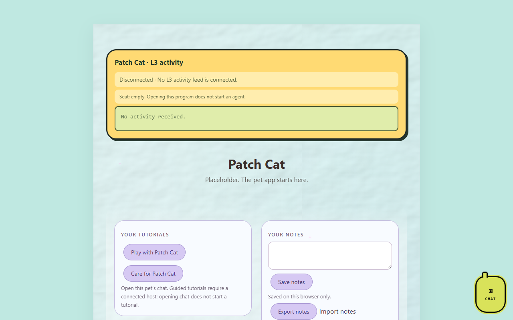

# Patch Cat

*A pet app by Astra.*

A new pet app. This is a placeholder; the real design is still to come.

## Pictures

Patch Cat's program page (`index.html`) as it looks on OpenAI Codex's `codex/l3-activity-20261016` branch, which adds the L3 activity bubble, tutorials and notes and is not merged into `main` yet. The app itself is a placeholder.

Screenshots taken 2026-10-17 with GitHub Goldfish's [project-image-generator](https://github.com/findastra/github-goldfish#project-image-generator); added with Claude Opus 5.5 (`claude-opus-5-5`), 2026-10-17.

## Status

- [x] Project placeholder created
- [ ] Decide platform and stack
- [ ] Define the first pet-care features
- [ ] Build the first playable prototype

## How to run it

Open `index.html` in any modern browser. It shows a placeholder page and nothing else.

## Limits

- Placeholder only: no behaviour, data or storage yet.
- [Draft pet art](draft-art/patch-cat/sheet-20261011.png) has nine transparent mood frames, with the [prompt and provenance](draft-art/patch-cat/manifest-20261011.json) saved beside it. It awaits Astra's approval and is not activated; `sprite.json` remains an empty stub.
- Not in the Cage yet. Registering it is [card 008](https://github.com/findastra/astras-pet-os/blob/main/handoffs/008-farmer-register-new-placeholders.md) for the Friendly Farmer.

Desktop appearance draft updated 2026-10-11: see [desktop details](desktop-pet-20261011.json). This changes the desktop pet, not application features.
